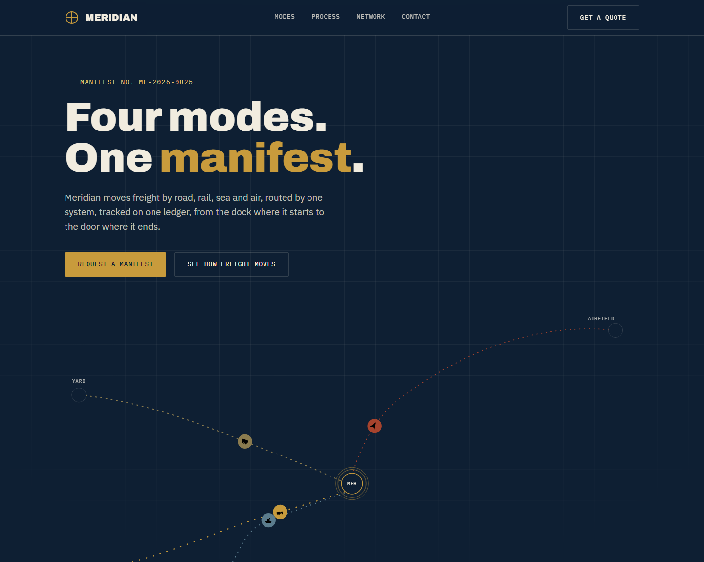
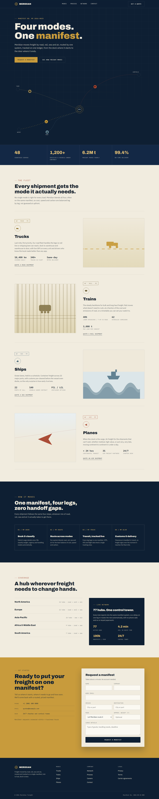
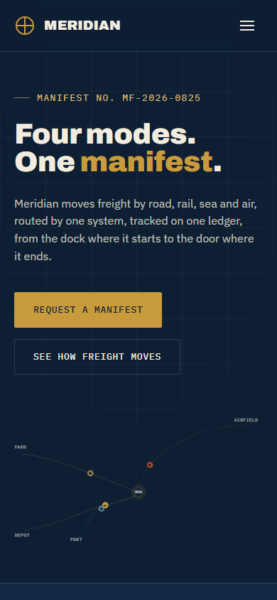

# Freight Website Rewrite

A polished, fully working version of the **Meridian Freight** website design: one manifest for road, rail, sea and air freight. It is a single self-contained file, `index.html`, with no build step. The only external resource is Google Fonts.

Open `index.html` in any browser to view it.

## Preview

### Desktop

Full desktop page

### Mobile

Full mobile page

## What was improved

**Everything now works**
- **Mobile menu:** The original menu was positioned inside a blurred header, which made the fixed overlay collapse to almost nothing. It now fills the screen below the header, locks page scroll, closes on link click or `Esc`, animates the icon into an X and updates `aria-expanded`.
- **Quote form:** The "Request a quote" and "Talk to our team" buttons went nowhere (`#`). They are replaced by a real request form (name, company, email, origin, destination, mode, weight, details) with validation, inline errors and a generated manifest reference on success. It is a demo and nothing is sent.
- **Mode links:** Each of the four mode sections has a "Quote a ... shipment" link that pre-selects the matching mode in the form.
- **Footer:** Careers, Privacy, Terms and Carrier agreements (all dead links) now open info dialogs with placeholder text.
- **Phone and email:** `tel:` and `mailto:` links with example values.
- Active section highlight in the nav, back to top button and a map label size that stays readable on phones.

**Quality**
- The stat counters now show the real values in the page and animate on top, so they are correct without JavaScript or with reduced motion. They also no longer depend on `requestAnimationFrame` timing.
- Skip link, focus styles, ARIA labels, decorative SVGs hidden from screen readers and `prefers-reduced-motion` support.
- Several muted text colours were darkened for better contrast on the paper and ink backgrounds.
- All em dashes and en dashes removed from the copy and title.

The original fonts, layout and colour palette were kept.

## Before going live

- Replace the example phone number and email (`+1 (000) 000 0000`, `quotes@example.com`).
- Replace the placeholder text in the Careers, Privacy, Terms and Carrier agreements dialogs.
- Connect the quote form to your own endpoint or form service. It currently shows a demo confirmation only.

## License

Released under the [MIT License](LICENSE).
